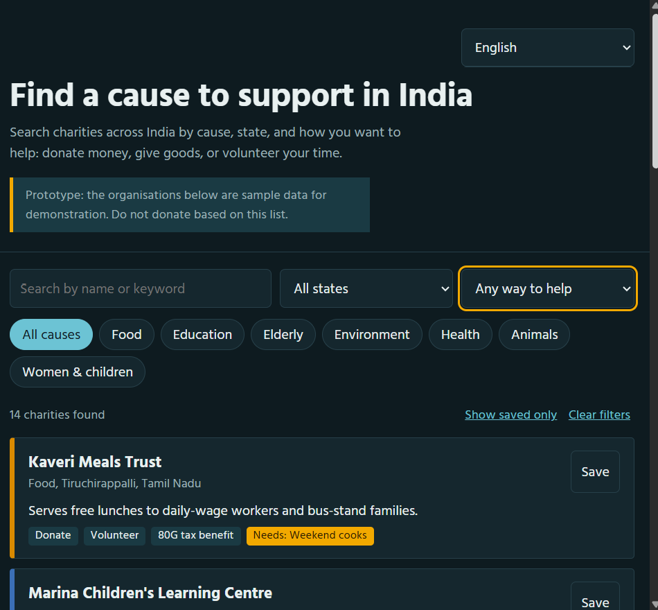

# Charity Finder: India

**Live demo:** https://anu-bharanika.github.io/charity-finder/



A prototype web app that helps people across India find charities by cause, state, and how they want to help (donate, give goods, or volunteer).

> **Prototype:** the charities listed are sample data for demonstration, not real organisations. The "80G tax benefit" tags are sample values too.

## Features
- Search by name or keyword
- Filter by cause, state, and way to help
- Save charities to a personal shortlist (kept in the browser via `localStorage`)
- Six languages: English, Hindi, Tamil, Telugu, Kannada, Malayalam (choice is remembered)
- Responsive, keyboard accessible, supports light and dark mode

## Run it
No build step, but the page loads `charities.json` and `translations.json`, so browsers need it served over HTTP (opening the file directly won't work). From this folder run:

```
python -m http.server 8000
```

Then open http://localhost:8000. It also works as-is on GitHub Pages.

## Project structure
- `index.html`: page, styles, and app logic
- `charities.json`: the charity data (edit this to add or change entries)
- `translations.json`: interface text, cause, state, and way-to-help names for each language

## Tech
HTML, CSS, and vanilla JavaScript. Data is loaded with `fetch`.

## Roadmap
- [ ] Replace sample data with verified charities (website, contact, 80G/12A status, and verification date for each)
- [x] Language toggle for the interface (six languages)
- [ ] Translate charity descriptions: add `text_hi`, `text_ta`, `text_te`, `text_kn`, `text_ml` (and `need_xx`) fields to entries in `charities.json`; the app uses them automatically and falls back to English
- [ ] Have native speakers review the translations
- [x] Move data to a JSON file
- [ ] Replace the JSON file with a small API
- [ ] Filter by city and a map view
- [ ] Submit-a-charity form with review step